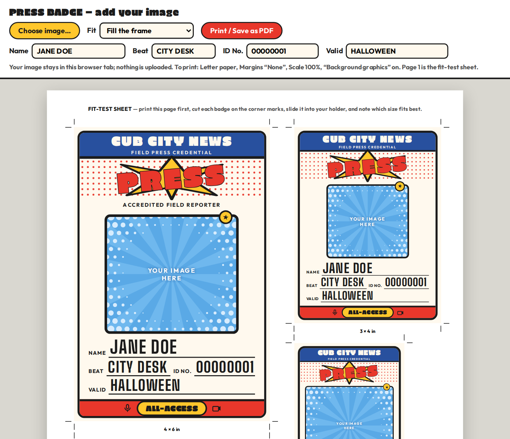

# Press Badge Generator

A single-file HTML tool that makes printable **"PRESS" credential badges** sized for standard conference badge holders. Pick an image, type a name, print. Built for a kid's Halloween news-reporter costume, with a bold comic-book look: thick outlines, halftone dots, primary colors.

## Features

- **Bring your own picture.** Choose any image and it appears in every badge frame instantly.
- **Editable details.** Name, Beat, ID No. and Valid date update on every sheet as you type.
- **Four holder sizes on US Letter paper**, each with corner cut marks:

  | Page | Size | Layout | Badges per sheet |
  |------|------|--------|------------------|
  | 1 | Fit-test sheet (all four sizes) | mixed | 1 of each |
  | 2 | 3 × 4 in | portrait | 4 |
  | 3 | 4 × 3 in | landscape | 3 |
  | 4 | 4 × 6 in | portrait | 1 |
  | 5 | 2¼ × 3½ in | portrait | 6 |

- **Offline and private.** One HTML file, no build step, no dependencies, fonts embedded. Images are read by your browser and never uploaded.

## Quick start

1. Open `index.html` in a modern browser (double-click it).
2. Click **Choose image…**. Use **Fit** to fill the frame or show the whole image.
3. Edit the Name / Beat / ID No. / Valid fields.
4. Click **Print / Save as PDF** and set: **Paper** Letter · **Margins** None · **Scale** 100% (not "Fit to page") · **Background graphics** on.

Print **page 1** first, cut the badges out on the corner marks, and slide them into your holders to see which size fits. Then print the matching page (choose its page number in the print dialog), ideally on cardstock.

### Image quality

The tool shows the effective resolution after you load an image. As a rule of thumb you need roughly 500 px of width for the 3 × 4 frame and 800 px for the 4 × 6 frame to print crisp (300 dpi). Small images look soft at the larger sizes.

## Publish with GitHub Pages

Name the file `index.html` at the repo root, then go to **Settings → Pages → Build and deployment**, set **Source** to *Deploy from a branch*, choose `main` and `/ (root)`, and save. The site appears at `https://<user>.github.io/<repo>/`. See the [GitHub Pages docs](https://docs.github.com/en/pages).

## Customizing

The file is generated markup, so edits are find-and-replace in a text editor:

- **Outlet name:** replace `CUB CITY NEWS` (it appears once per badge, 18 times). `FIELD PRESS CREDENTIAL` and `ALL-ACCESS` work the same way.
- **Colors:** replace the hex values `#28509e` (blue), `#e8372b` (red), `#ffc72c` (gold), `#fff9ee` (cream) and `#1b1b1b` (ink).

## Limitations

- Fixed set of sizes. There is no custom-size option; a new size means adding another badge block by hand.
- Typed values and the loaded image are not saved between sessions.
- Very long text can overflow its line (about 14 characters fit the Valid line at every size).
- Developed and tested in Chromium (Chrome/Edge). Other browsers should work, but their print dialogs name the options differently.

## Credits and licenses

Three fonts are embedded, each under the [SIL Open Font License 1.1](https://openfontlicense.org). Full texts are in [`FONT-LICENSES.txt`](FONT-LICENSES.txt).

- **Erica One** © 2011 LatinoType Limitada
- **Big Shoulders** © 2019 The Big Shoulders Project Authors ([source](https://github.com/xotypeco/big_shoulders))
- **Outfit** © 2021 The Outfit Project Authors ([source](https://github.com/Outfitio/Outfit-Fonts))

## Disclaimer

This is an unofficial fan project, not affiliated with or endorsed by any author, publisher or studio. It ships with no third-party artwork. You supply your own images and are responsible for having the right to use them.

## License

Code: MIT. The embedded fonts keep their own licenses, listed above.
